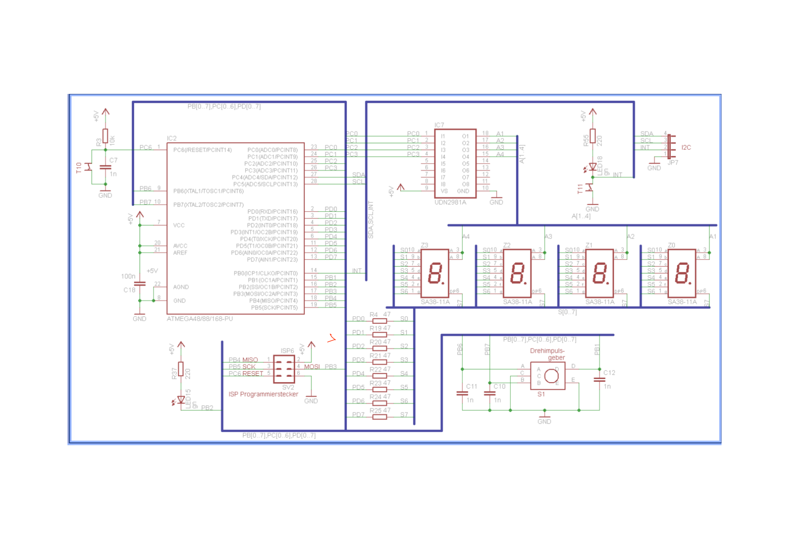
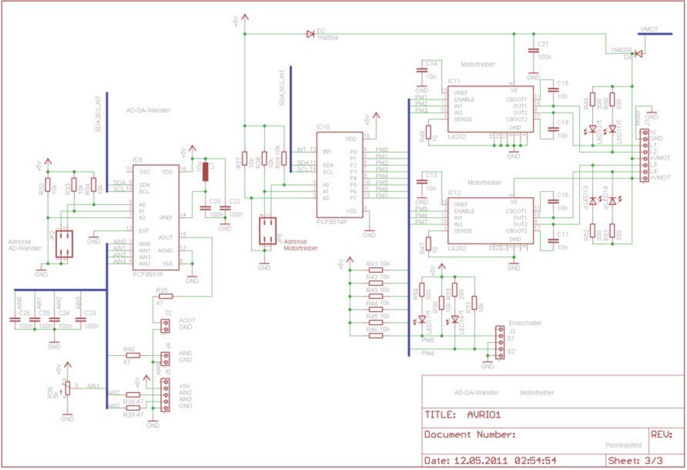
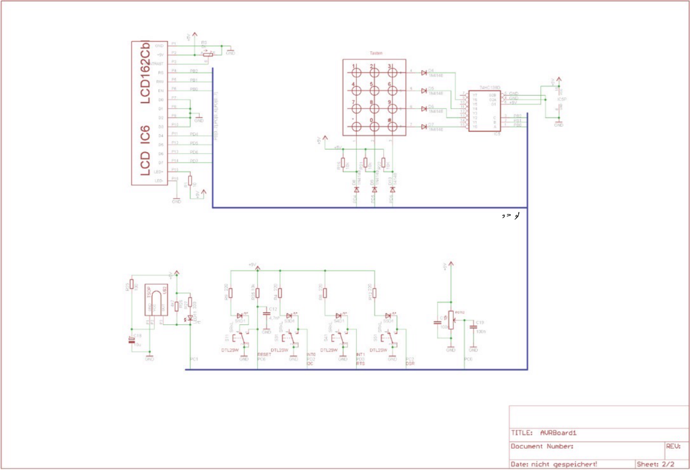
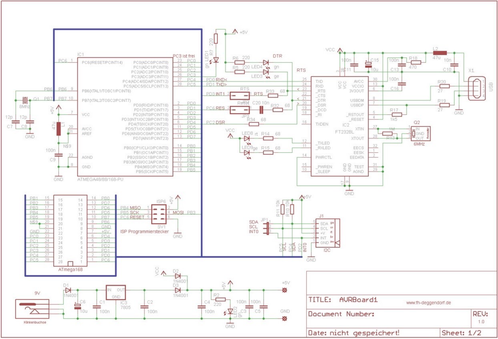

# AVR Stepper Motor Control System

An AVR-based embedded system for stepper motor control using a Master-Slave architecture and I2C communication.

The project is developed in C/C++ and integrates motor control, peripheral interfacing, serial communication, and user interaction.

## Project Overview

The system consists of two AVR-based software modules communicating through the I2C protocol.

### 1. AVR Master Controller

The Master application is responsible for the main control logic and peripheral management.

Main software modules:
- Stepper Motor Control
- I2C Communication
- UART Communication
- LCD Interface
- Matrix Keypad Interface
- Timer Module
- FIFO Buffer Implementation
- Emergency Stop and Limit Switch Handling

### 2. AVR Slave Controller

The Slave application handles I2C communication with the Master and provides display-related functionality.

Main software modules:
- I2C Slave Communication
- LED Matrix Interface
- Timer Module

## System Architecture

```text
       User Input
    (Matrix Keypad)
           |
           v
  +-------------------+
  |    AVR MASTER     |
  |                   |
  |  ATmega Controller|
  +-------------------+
       |          |
       |          +------ LCD Display
       |
       +------ Stepper Motor Driver
       |          |
       |          +------ Stepper Motor
       |
       | I2C (SDA/SCL)
       |
       v
  +-------------------+
  |     AVR SLAVE     |
  |                   |
  |  ATmega Controller|
  +-------------------+
           |
           v
      LED Matrix
```

*Conceptual representation of the Master-Slave system architecture.*

## Hardware Design

The hardware documentation includes the following circuit schematics.

### 1. AVR Display and Controller Circuit



### 2. Stepper Motor Driver Circuit



### 3. LCD and Keypad Circuit



### 4. AVR Controller Board – USB, UART and I2C



## Technologies and Interfaces

- Programming Languages: C / C++
- Microcontroller Family: AVR
- Communication Protocol: I2C
- Serial Communication: UART
- Display Interfaces: LCD and LED Matrix
- User Input: Matrix Keypad
- Motor Control: Stepper Motor
- Development: Embedded C/C++ and Modular Firmware

## Repository Structure

```text
avr-stepper-motor-control/
|
|-- AVR_Application_Master/
|
|-- AVR01_Slave_I2C/
|
|-- docs/
|   |-- AVR_Display_and_Controller_Circuit.png
|   |-- Stepper_Motor_Driver_Circuit.png
|   |-- LCD_Keypad_and_Input_Circuit.png
|   |-- AVR_Controller_Board_USB_UART_I2C.png
|
|-- README.md
```

## Key Learning Outcomes

- AVR microcontroller programming using C/C++.
- Master-Slave communication using I2C.
- Peripheral interfacing and hardware integration.
- Stepper motor control.
- Modular embedded software development.
- Hardware-level debugging and troubleshooting.

## Author

**Mohamed Aly**

Electrical and Information Engineering

Deggendorf Institute of Technology
